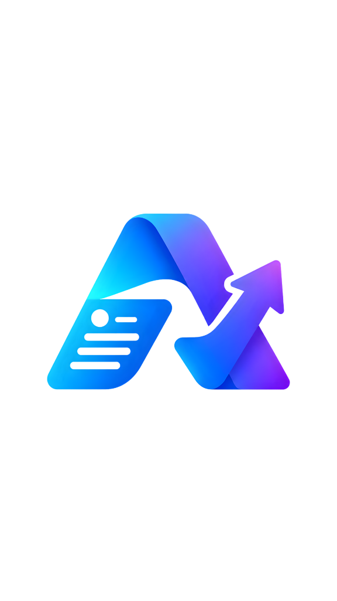

<div align="center">



# 🚀 AyoKerja — Platform Karier Impian

**Platform karier berbasis AI yang membantu kamu dari CV hingga wawancara kerja**

[](https://laravel.com)
[](https://react.dev)
[](https://inertiajs.com)
[](https://tailwindcss.com)
[](https://php.net)
[](LICENSE)

[🌐 Live Demo](https://lomba.kemaswebstudio.id) · [📖 Dokumentasi](#-cara-penggunaan) · [🐛 Laporkan Bug](https://github.com/kms-muhammad-al-qodri/AyoKerja-PlatfromKarierImpian/issues)

</div>

---

## 📌 Tentang Proyek

**AyoKerja** adalah platform karier cerdas yang memanfaatkan kekuatan **Artificial Intelligence (DeepSeek AI)** untuk membantu pencari kerja Indonesia mempersiapkan diri secara menyeluruh — mulai dari analisis CV, pencarian lowongan kerja real-time, pembuatan cover letter profesional, peta karier, hingga simulasi wawancara kerja interaktif.

> 🏆 Dibuat sebagai submission lomba **APEX Rafatech** — kategori Platform Karier Berbasis AI.

---

## ✨ Fitur Utama

| Fitur | Deskripsi |
|-------|-----------|
| 🤖 **Analisis CV dengan AI** | Upload CV (PDF) dan dapatkan skor, feedback mendalam, serta saran perbaikan dari AI |
| 🔍 **Job Matching Real-Time** | Lowongan kerja live dari **Adzuna** & **Jooble** API yang disesuaikan profil kamu |
| 📄 **CV Builder** | Buat CV profesional dari nol dengan bantuan AI, export ke PDF |
| ✉️ **Cover Letter Builder** | Generate cover letter yang dipersonalisasi sesuai posisi yang dilamar |
| 🗺️ **Career Roadmap** | Konsultasikan jalur karier impianmu dan dapatkan peta jalan yang terstruktur |
| 🎤 **Interview Simulator** | Latihan wawancara interaktif dengan AI coach yang memberikan feedback real-time |
| 🌐 **Bilingual (ID/EN)** | Antarmuka dan konten tersedia dalam Bahasa Indonesia & English |
| 🎨 **Animated Robot Mascot** | Maskot robot animasi yang memandu pengguna di setiap langkah |
| 🔐 **Demo Login** | Bisa langsung coba tanpa perlu daftar akun |

---

## 🛠️ Tech Stack

### Backend
- **Laravel 12** — Framework PHP modern
- **Inertia.js** — Jembatan antara Laravel dan React (SPA tanpa API terpisah)
- **MySQL** — Database relasional
- **smalot/pdfparser** — Parsing file PDF CV

### Frontend
- **React 19** — UI library
- **TailwindCSS 4** — Utility-first CSS
- **Framer Motion** — Animasi halus dan interaktif
- **Lucide React** — Icon set modern
- **i18next** — Internasionalisasi (ID/EN)
- **html2pdf.js / jsPDF** — Export ke PDF

### AI & External APIs
- **DeepSeek AI** — Analisis CV, career roadmap, cover letter, interview simulator
- **Adzuna API** — Lowongan kerja live (internasional)
- **Jooble API** — Lowongan kerja live (lokal & global)

### DevOps & Tools
- **Vite 7** — Build tool super cepat
- **GitHub Actions** — CI/CD pipeline otomatis

---

## 📦 Prasyarat

Pastikan sistem kamu sudah terinstall:

- **PHP** >= 8.2
- **Composer** >= 2.x
- **Node.js** >= 20.x & **npm** >= 10.x
- **MySQL** >= 8.0
- **Git**

---

## 🚀 Cara Penggunaan

### 1. Clone Repository

```bash
git clone https://github.com/kms-muhammad-al-qodri/AyoKerja-PlatfromKarierImpian.git
cd AyoKerja-PlatfromKarierImpian
```

### 2. Install Dependensi PHP (Composer)

```bash
composer install
```

### 3. Install Dependensi JavaScript (NPM)

```bash
npm install
```

### 4. Setup Environment

```bash
# Salin file konfigurasi
cp .env.example .env

# Generate application key
php artisan key:generate
```

Lalu edit file `.env` dan isi konfigurasi berikut:

```env
# Database
DB_CONNECTION=mysql
DB_HOST=127.0.0.1
DB_PORT=3306
DB_DATABASE=nama_database_kamu
DB_USERNAME=username_mysql
DB_PASSWORD=password_mysql

# DeepSeek AI (https://platform.deepseek.com)
DEEPSEEK_API_KEY=your_deepseek_api_key_here

# Adzuna Job API (https://developer.adzuna.com)
ADZUNA_APP_ID=your_adzuna_app_id
ADZUNA_APP_KEY=your_adzuna_app_key

# Jooble Job API (https://jooble.org/api/about)
JOOBLE_API_KEY=your_jooble_api_key
```

### 5. Setup Database

```bash
# Buat database di MySQL, lalu jalankan migrasi
php artisan migrate

# (Opsional) Jalankan seeder untuk data awal
php artisan db:seed
```

### 6. Setup Storage

```bash
php artisan storage:link
```

### 7. Build Assets

```bash
# Mode development (dengan hot reload)
npm run dev

# Mode production (build final)
npm run build
```

### 8. Jalankan Aplikasi

```bash
# Jalankan semua service sekaligus (server + queue + vite + logs)
composer run dev
```

Atau jalankan manual satu per satu:

```bash
# Terminal 1 — Laravel server
php artisan serve

# Terminal 2 — Vite dev server
npm run dev

# Terminal 3 — Queue worker (untuk job processing AI)
php artisan queue:listen --tries=1
```

Buka browser dan akses: **http://localhost:8000** 🎉

---

## 🗂️ Struktur Direktori

```
AyoKerja/
├── app/
│   ├── Http/
│   │   ├── Controllers/          # AuthController, DashboardController, CvAnalysis, dll
│   │   └── Middleware/           # HandleInertiaRequests
│   ├── Models/                   # User, CvProfile, CvAnalysis, JobPosting, dll
│   └── Services/
│       ├── AiCareerService.php   # Integrasi DeepSeek AI
│       ├── CvParserService.php   # Parser PDF CV
│       └── JobFetcherService.php # Integrasi Adzuna & Jooble API
├── database/
│   └── migrations/               # Skema database lengkap
├── public/
│   └── assets/                   # Logo, gambar, robot mascot (webp/webm)
├── resources/
│   ├── css/app.css               # Stylesheet utama
│   └── js/
│       ├── Components/           # Reusable UI components
│       ├── Layouts/              # AppLayout, DashboardLayout
│       ├── Pages/                # Landing, Login, Register, Dashboard, dll
│       │   └── Dashboard/        # Overview, CvAnalysis, CvBuilder, JobMatches, dll
│       └── i18n/                 # Terjemahan ID & EN
├── routes/web.php                 # Semua route aplikasi
├── .env.example                  # Template konfigurasi environment
└── composer.json                 # Dependensi PHP
```

---

## 🌐 Rute Aplikasi

| Route | Deskripsi |
|-------|-----------|
| `GET /` | Halaman landing utama |
| `GET /login` | Halaman login |
| `GET /register` | Halaman registrasi |
| `POST /auth/demo` | Login demo (tanpa daftar) |
| `GET /dashboard` | Dashboard utama (perlu login) |
| `GET /analyze-cv` | Halaman analisis CV |
| `POST /upload-cv` | Upload & proses CV |
| `POST /api/career-ai/chat` | Chat dengan AI Career Coach |
| `POST /api/career-roadmap/consult` | Konsultasi peta karier |
| `POST /api/cv-builder/enhance` | Enhance CV dengan AI |
| `POST /api/cover-letter/generate-content` | Generate cover letter |

---

## 🔑 Mendapatkan API Keys

### DeepSeek AI
1. Daftar di [platform.deepseek.com](https://platform.deepseek.com)
2. Buat API Key baru di menu **API Keys**
3. Salin ke `DEEPSEEK_API_KEY` di `.env`

### Adzuna API
1. Daftar di [developer.adzuna.com](https://developer.adzuna.com)
2. Buat aplikasi baru, dapatkan `App ID` dan `App Key`
3. Isi `ADZUNA_APP_ID` dan `ADZUNA_APP_KEY` di `.env`

### Jooble API
1. Kirim request ke [jooble.org/api/about](https://jooble.org/api/about)
2. Dapatkan API key via email
3. Isi `JOOBLE_API_KEY` di `.env`

---

## ⚙️ Konfigurasi Opsional

### Mode Production
```bash
# Optimasi untuk production
php artisan config:cache
php artisan route:cache
php artisan view:cache
php artisan optimize

npm run build
```

### Menjalankan Queue Worker
AI processing dijalankan secara asynchronous menggunakan Laravel Queue:
```bash
php artisan queue:work --sleep=3 --tries=3
```

---

## 🤝 Kontribusi

Kontribusi sangat disambut! Ikuti langkah berikut:

1. **Fork** repository ini
2. Buat branch fitur baru: `git checkout -b feature/fitur-keren`
3. Commit perubahan: `git commit -m 'feat: tambah fitur keren'`
4. Push ke branch: `git push origin feature/fitur-keren`
5. Buat **Pull Request**

---

## 📄 Lisensi

Proyek ini dilisensikan di bawah **MIT License** — lihat file [LICENSE](LICENSE) untuk detail.

---

## 👤 Tim Pengembang

<div align="center">

**kms-muhammad-al-qodri**

Dikembangkan dengan ❤️ untuk lomba **APEX Rafatech**

[](https://github.com/kms-muhammad-al-qodri)

</div>

---

<div align="center">

⭐ **Jika proyek ini membantu, jangan lupa kasih bintang!** ⭐

</div>
